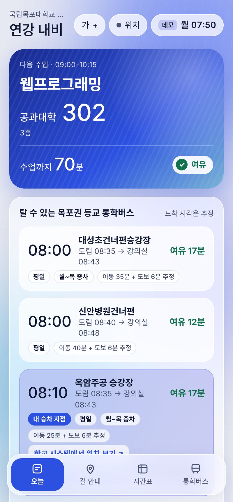
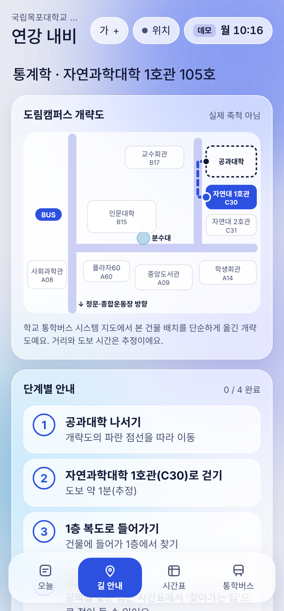
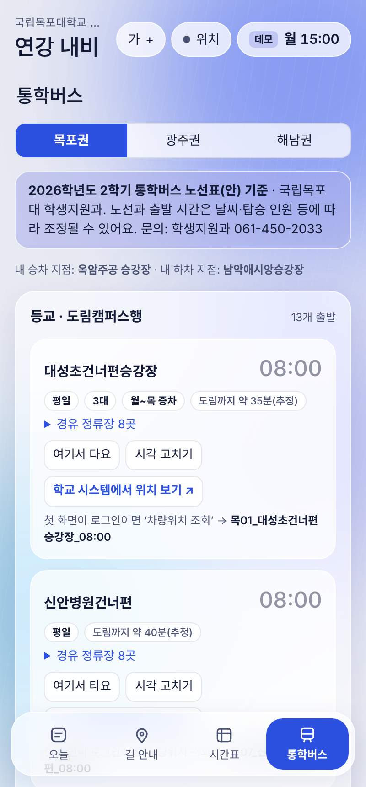
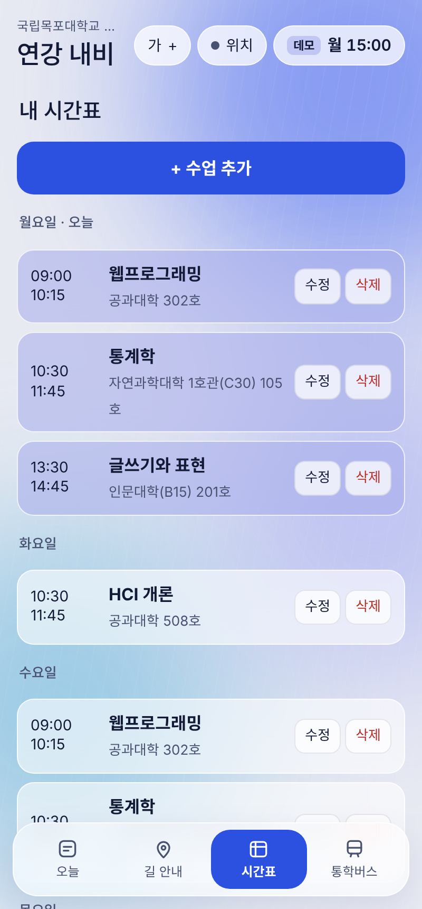
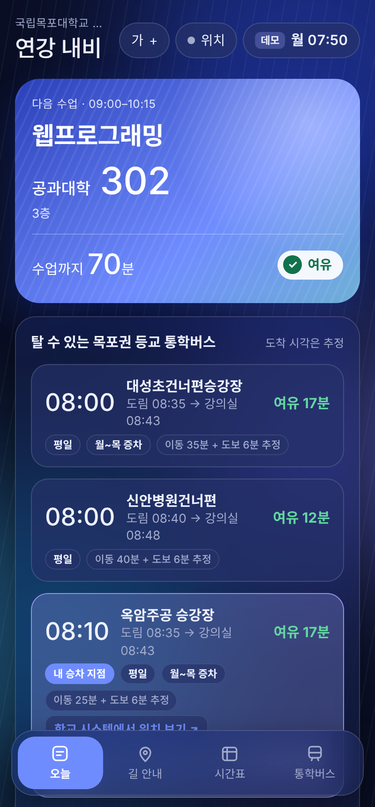
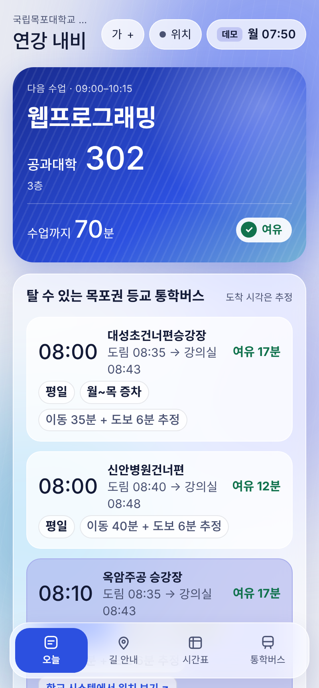

# 연강 내비: 다음 강의실까지 몇 분?

국립목포대학교 도림캠퍼스 통학생이 등교하거나 연강 사이에 이동할 때 **통학버스 시각, 강의실 위치, 수업까지 남은 여유 시간**을 한 화면에서 확인할 수 있게 해 주는 모바일 웹앱입니다.

- **바로 써 보기:** https://ayeony.github.io/yeongang-navi/ (휴대폰에서 열면 홈 화면에 앱으로 추가할 수 있음)
- **기획 근거:** Chapter 02 UI 디자인 방법론 워크북(통합 캠퍼스 라이프 앱), Chapter 05 맥락질의 워크북(장거리 통학생 등교 관찰)
- **구현:** Claude Code(Claude)에 프롬프트를 입력해 구현. 프롬프트 기록은 [`PROMPTS.md`](PROMPTS.md)
- **형태:** 설치·서버가 필요 없는 정적 웹앱(HTML, CSS, JavaScript)

| 오늘 | 길 안내 | 통학버스 |
|---|---|---|
|  |  |  |

| 시간표 | 다크 모드 | 글자 크게 |
|---|---|---|
|  |  |  |

## 1. 처음 써 보는 순서

1. **오늘 탭**을 엽니다. 다음 수업, 강의실, 수업까지 남은 시간, 여유 상태(여유/빠듯/아슬아슬/지각 위험)가 맨 위에 나옵니다.
2. 오른쪽 위 **시계 버튼**을 눌러 시나리오를 고릅니다. 평일 낮에는 실제 시각으로, 그 밖에는 데모 시각(월 07:50)으로 열립니다.
   - 월 07:50 등교 준비: 탈 수 있는 통학버스와 각 버스의 강의실 도착 시각
   - 월 08:13 통학버스 놓침: 내 승차 지점 버스를 놓쳤을 때 대체 버스 추천
   - 월 10:16 연강 이동: 공과대학 → 자연과학대학 도보 시간과 '늦어도 출발할 시각'
   - 월 15:00 하교: 수업이 끝난 뒤 탈 하교 통학버스
3. **통학버스 탭**에서 내 지역(목포권/광주권/해남권)의 승차 지점에 '여기서 타요', 하차 지점에 '여기서 내려요'를 누릅니다.
4. **시간표 탭**에서 내 수업을 추가합니다. 수업마다 '찾아가는 팁'(예: 3층 엘리베이터 내려서 오른쪽 끝)을 적어 두면 길 안내 마지막 단계에 나옵니다.
5. **길 안내 탭**에서 개략도와 단계별 안내를 따라가고, 도착하면 '도착했어요'를 누릅니다.
6. 버스가 어디쯤인지 궁금하면 버스마다 있는 **학교 시스템에서 위치 보기**를 누릅니다.

## 2. 프로젝트 목적

### 문제 (02 워크북 최종 문제문장)

> 장거리 통학생은 등교 및 연강 수업 직전 이동 상황에서 도착 예상 시간에 맞는 셔틀버스 시간과 다음 강의실 위치를 한눈에 파악해 제시간에 도착하고자 한다. 그러나 교통 정보와 시설 정보가 서로 다른 포털과 PDF 파일로 흩어져 있어, 여러 앱을 오가며 검색하느라 시간을 허비하고 버스를 놓치거나 수업에 지각하는 일을 겪는다.

### 근거

| ID | 내용 | 출처 |
|---|---|---|
| E01 | 셔틀시간표 PDF, 홈페이지 지도, 학사 포털을 번갈아 새로고침함 | 02 워크북 현장 관찰 |
| E02 | "셔틀버스 시간이 종종 조정되는 경우가 있어 매번 따로 확인을 해봐야 해요." | 02 워크북 인터뷰 |
| E03 | 학기 초 '셔틀 언제 오냐', '공학관 302호 어디냐' 질문글이 많음 | 02 워크북 커뮤니티 자료 |
| I01~I03 | 교차 확인, '지금 탈 수 있는가'의 중요성, 건물 안 길찾기 공백 | 05 맥락질의 워크북 인사이트 |

### 목표 (02 워크북 검증 계획)

- 앱을 실행한 뒤 버스 시각과 강의실 층수를 확인하기까지의 시간: 기존 45초에서 **15초 이내**로 줄이기 (가상 목표값)
- 추가 검색 없이 첫 화면과 길 안내만으로 정확한 정보를 얻는 비율: **90% 이상** (가상 목표값)

## 3. 사용자 요구사항 → 기능 매핑

| 요구사항 | 근거 | 구현한 기능 |
|---|---|---|
| R1. 다음 수업, 탈 버스, 강의실 위치를 한 화면에서 본다 | E01, I01 | **오늘 탭**: 다음 수업, 강의실, 남은 시간, 탈 수 있는 통학버스 |
| R2. 이 버스를 타면 늦지 않는지, 놓치면 어떻게 되는지 안다 | I02, 05-C02 | 버스마다 **강의실 도착 예상 시각과 여유 시간**, 내 승차 지점 버스를 놓쳤을 때 대체 버스 추천 |
| R3. 정보가 최신인지 믿을 수 있다 | E02, I01 | 노선표 기준 표시, **추정값 표시**, 데이터 출처, 시각 직접 수정 |
| R4. 연강일 때 지금 건물에서 언제 출발해야 하는지 안다 | 02 사용 맥락 | 직전 수업 건물을 출발지로 **자동 판단**, '늦어도 ○○:○○에 출발' 안내 |
| R5. 건물과 강의실까지 헤매지 않는다 | E03, I03, 05-C03 | **길 안내 탭**: 캠퍼스 개략도 경로, 단계별 체크, 강의실 찾는 팁 |
| R6. 도착했을 때 여유를 바로 확인한다 | 02 3프레임 중 3번 | '도착했어요' → '○○:○○ 도착 · 수업 ○분 전' |
| R7. 추천이 맞지 않으면 직접 바꾸고 원본을 볼 수 있다 | 02 Human–AI 점검 | 출발지 직접 선택, **통학버스 탭(전체 노선)**, 학교 통학버스 시스템 연결 |
| R8. 내 시간표를 넣고 고칠 수 있다 | — | **시간표 탭**: 추가, 수정, 삭제(되돌리기 가능), 예시 시간표로 초기화 |
| R9. 내가 지금 어디 있는지에 맞춰 계산한다 | 02 Human–AI 점검(실시간 위치) | **현재 위치**로 캠퍼스 안/밖 판단, 기준점 보정 |
| R10. 작은 글씨나 어두운 환경에서도 읽을 수 있다 | 02 비판 검토(소외 사용자) | **글자 크게** 버튼, 다크 모드, 색과 글자·기호를 함께 쓰는 상태 표시 |

## 4. 주요 기능

1. **오늘의 이동 카드:** 현재 시각과 출발지로 다음 수업을 찾고, 여유 시간에 따라 `여유 / 빠듯 / 아슬아슬 / 지각 위험` 상태를 보여 줍니다.
2. **통학버스 여유 계산:** 버스 출발 + 도림캠퍼스까지 이동(추정) + 정류소에서 건물까지 도보 + 층 이동 = 강의실 도착 예상 시각. 내 승차 지점 버스를 놓치면 같은 지역에서 제시간에 도착하는 다른 버스를 추천합니다.
3. **하교 안내:** 오후에는 오늘 마지막 수업이 끝난 뒤 탈 수 있는 하교 통학버스를, 수업이 다 끝나면 남은 하교 버스를 보여 줍니다.
4. **연강 출발 안내:** 건물 사이 도보 시간과 층 이동 시간으로 '늦어도 출발할 시각'을 계산합니다.
5. **강의실까지 길 안내:** 학교 통학버스 시스템 지도에서 본 배치를 바탕으로 그린 개략도에 경로를 표시하고, 단계별 체크와 도착 피드백을 제공합니다.
6. **통학버스 탭:** 광주권·목포권·해남권 등교·하교 버스 전체를 운행 요일(평일/월~목/금요일 변경), 차량 대수, 경유 정류장과 함께 보여 줍니다. 승차·하차 지점 지정, 시각 직접 수정(되돌리기 가능), 다른 교통편 안내를 제공합니다.
7. **학교 시스템 위치 보기:** 버스마다 학교 통학버스 시스템의 해당 노선 위치 화면으로 연결합니다. 첫 화면이 로그인으로 나오면 '차량위치 조회'와 노선 이름을 안내합니다.
8. **현재 위치:** 캠퍼스 안이면 목포대정류소 출발로, 밖이면 통학버스 이용으로 계산합니다. 위치 정보는 기기 안에서만 쓰고 전송하지 않습니다.
9. **홈 화면에 추가(PWA):** 휴대폰 홈 화면에 앱 아이콘으로 설치할 수 있고, 한 번 연 뒤에는 인터넷이 없어도 열립니다.
10. **접근성:** 글자 크게 보기, 다크 모드, 키보드 포커스 표시, 움직임 줄이기 설정 존중.

## 5. 데이터 출처

| 데이터 | 출처 | 상태 |
|---|---|---|
| 통학버스 노선·출발 시각·운행 요일 (광주권 38, 목포권 23, 해남권 2 출발) | 국립목포대 학생지원과 「2026학년도 2학기 통학버스 노선표(안)」 | 확인. 앱에서 직접 수정 가능 |
| 노선 번호, 차량 위치 화면, 캠퍼스 건물 배치 | 국립목포대 통학버스 시스템(mokpo.unibus.kr)의 노선 및 정거장, 차량위치조회 지도 | 등교 33개·하교 2개 노선 연결, 운행 중 위치 표시 확인 |
| 건물 코드 (A08, A09, A14, A60, B15, B17, C30, C31) | 국립목포대 캠퍼스맵 | 확인 |
| 캠퍼스 주소 | 국립목포대 홈페이지 | 확인 |
| 버스 출발부터 도림캠퍼스 도착까지 시간, 건물 간 도보 시간, 개략도의 거리, 캠퍼스 중심 좌표 | 노선표의 마지막 정류장 시각과 지도를 바탕으로 한 추정 | 추정. 앱에 '추정'으로 표시. 좌표는 '지금 위치를 캠퍼스로 저장'으로 보정 |

## 6. 범위와 한계

- **실시간 차량 위치:** 학교 시스템의 위치 데이터를 앱 화면 안에 직접 띄우지는 않고, 학교 시스템의 해당 노선 위치 화면으로 연결합니다. 학교 시스템은 처음 열 때 로그인 화면으로 시작하지만, 로그인 없이 '차량위치 조회'로 들어갈 수 있습니다.
- **현재 위치:** HTTPS 웹 주소(GitHub Pages)에서 동작합니다. Claude 아티팩트 미리보기에서는 브라우저가 위치 권한을 막습니다.
- **AI 기능:** 02 워크북에서 'AI 추천'으로 기획한 부분은 **규칙 기반 계산**으로 구현했습니다. 03 제안서의 축소 범위 원칙과 같습니다.
- 학사 시스템·출석 체크 연동은 포함하지 않았습니다. 시간표는 사용 중인 브라우저에만 저장됩니다.

## 7. 실행 방법

- 배포(GitHub Pages): https://ayeony.github.io/yeongang-navi/
- 저장소: https://github.com/AyeonY/yeongang-navi
- 미리보기(Claude 아티팩트): https://claude.ai/artifact/ExPW2SjGT6VwfZMPbmhMXM
- 로컬 실행: 폴더에서 `python3 -m http.server` 실행 후 `http://localhost:8000` 접속 (`index.html`을 바로 열어도 동작하지만 홈 화면 추가 기능은 꺼짐)

## 8. 파일 구성

| 파일 | 설명 |
|---|---|
| `index.html` | 화면 구조(상단 바, 4개 화면, 하단 탭) |
| `styles.css` | 디자인(블루 테마, 반투명 카드, 다크 모드, 글자 크게) |
| `app.js` | 데이터(통학버스·건물·예시 시간표)와 계산·화면 그리기 |
| `manifest.webmanifest`, `sw.js`, `icons/` | 홈 화면 추가(PWA)와 오프라인 실행 |
| `docs/` | README 화면 캡처 |
| `README.md` | 프로젝트 설명, 요구사항, 기능 요약 |
| `PROMPTS.md` | 개발에 사용한 프롬프트 기록(순서대로) |
